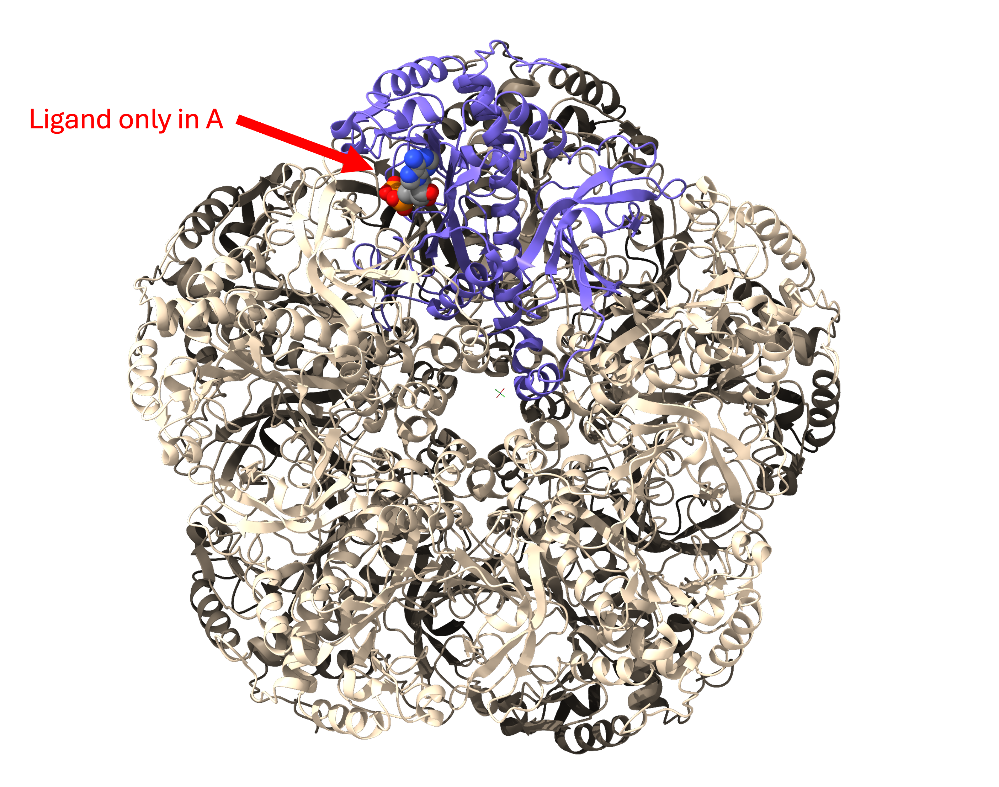
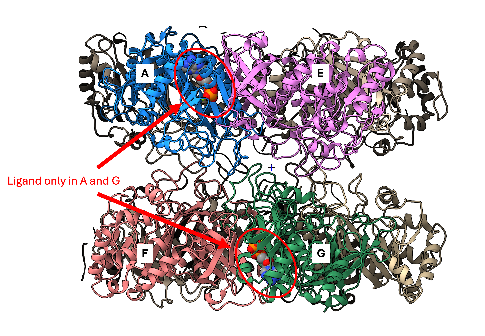
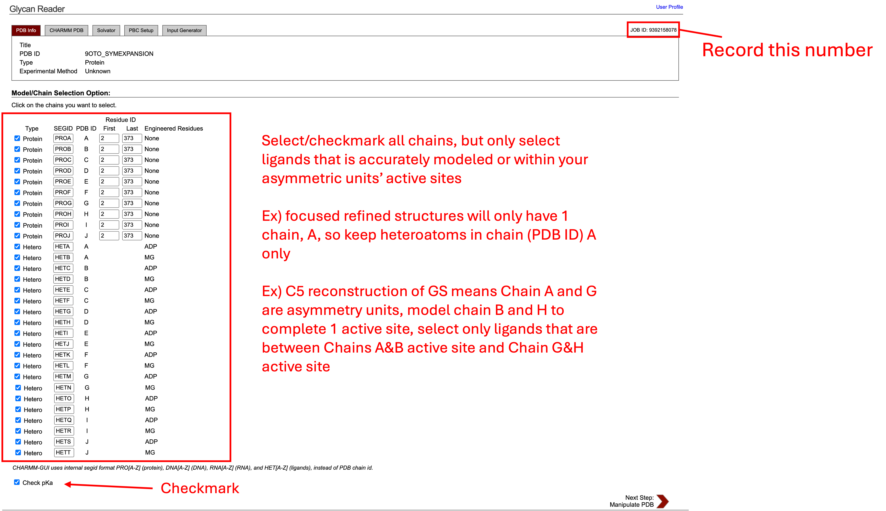
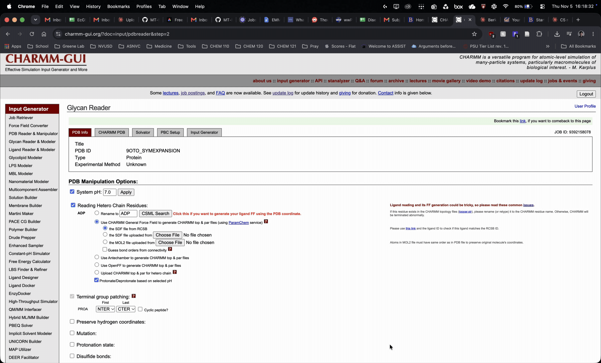
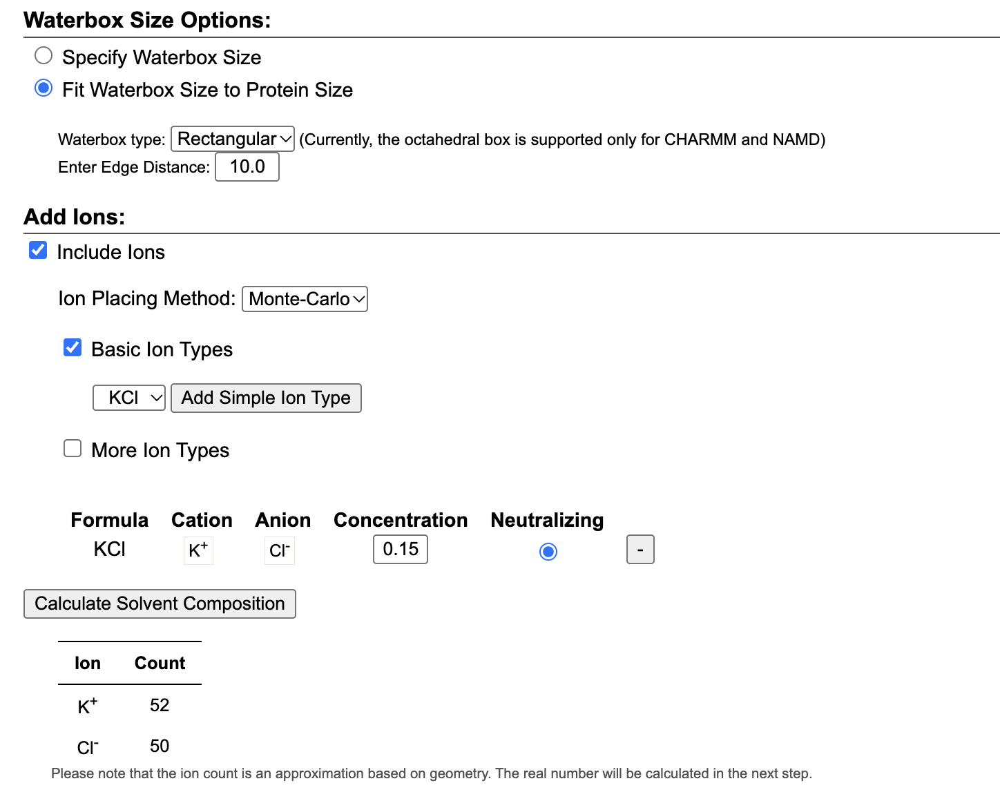
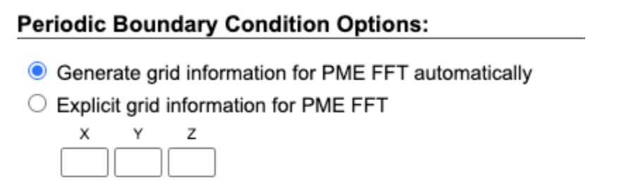
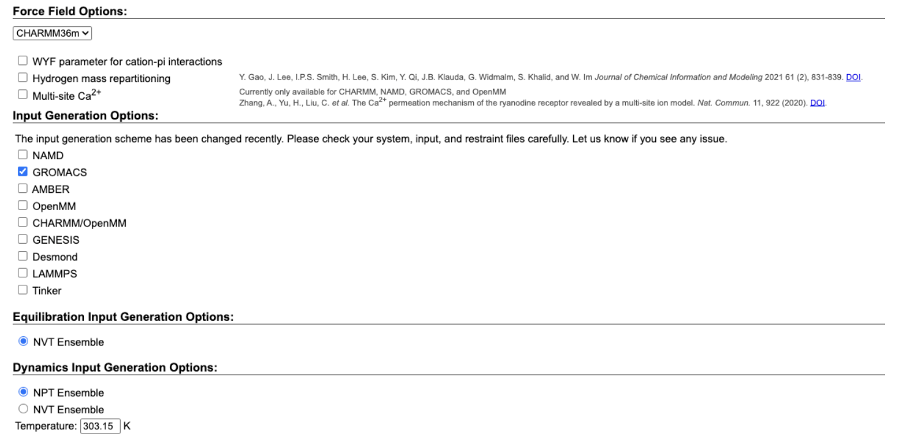

# Solvating and Neutralization utilizing CHARMM-GUI
Before beginning molecular dynamics-based refinement and ensemble modeling, we must first solvate and neutralize our structure with water and salt ions using [CHARMM-GUI](https://www.charmm-gui.org/).

CHARMM-GUI requires your `.pdb` file from previous single structure refinement jobs, preferrably the structure used for PDB deposition. 

To optimize ensemble modeling, it is recommended to only process the asymmetric unit determined by the symmetry operator as well as one complete active site. 

Additionally, certain systems may only have a single subunit solved due to focused refinement after symmetry expansion. 

In both of these cases, it is advised to model the full oligomeric assembly to ensure that the protein only samples conformations that is thermodynamically true. In EMMIVox, we can define what subunit and atoms to "mask" and run the pipeline on. For assistance in symmetry expanding visit the Refinements and Deposition guide, [Step 5 Symmetry Expansion](../Refinements+Depositions/Step5_SymmetryExpansion.md)

To make downstream processing easier, it is recommended to delete ligands in active sites where EMMIVox will not be applied.\
For example, in focused refined reconstructions that only have 1 subunit modeled (Chain or PDB ID A), delete ligands in all other chains to avoid incorrect selections in the next step.

Additionally, if modeling only the asymmetric unit, keep ligands within the full composite active site such as a C5 reconstruction in GS keeping the ligands present in the composite active site formed by Chains A and E as well as Chain F and G. 

## Preparing and uploding your model for CHARMM-GUI
Models, including any ligands, being input into CHARMM-GUI should be hydrogen free for pre-processing. CHARMM-GUI and EMMIVox will add hydrogens in downstream steps.

Navigate to [CHARMM-GUI](https://www.charmm-gui.org/) and login or register using your institutional email address. Then navigate to the input generator and select "Glycan Reader and Modeler".

Upload your `.pdb` file and allow for it to be read and processed. You do not need to select Check/Correct PDB Format.

Select applicable ligands based on what system you are modeling.

In this example we have selected all chains and all ligands due to C1 reconstruction so all subunits and active sites are unique from each other. Review previous guide if you have a different symmetry operator applied (i.e. C5) or if your structure is from a focus refined job from CryoSPARC.

## Step 1: PDB Reader and Manipulator
**Take and keep note of your session ID, this is the only way to return to your CHARMM-GUI session**
Note: data are held onto for 7 days before being purged from CHARMM-GUI servers

Once this page is reached, update pH conditions based on buffer conditions and ensure ligands use previously generated CHARMM Small Molecule Library (CSML) data or utilize other options (`.sdf` or `.mol2` files to generate ligand forcefield data.).\
Not all ligands are readily available in the CSML and may pose difficulty when advancing to the next step. In this case, you may use Claude to edit hetero atom names that mismatch with CHARMM naming conventions. 

## Step 2: Waterbox and Ion Neutralization
All default settings may be utilized for this step.
* Fit waterbox to protein size
* Include Ions
* Ion placement method: Monte Carlo
* KCl (0.15M, 150mM)

## Step 3: Periodic Boundary Conditions
Similarly to the previous step, keep the Periodic Boundary Conditions options as the default selection:
* Generate the grid information for PME FFT automatically

Then proceed to the next and final step.
## Step 4: Input Generation
In this last step, CHARMM-GUI will generate all the necessary input files for our simulations.\
Be sure to select **GROMACS** under Input Generation Options.

After successfully running, download the resulting `.tgz` file and decompress in your chosen directory to prepare transferring files for the next step.