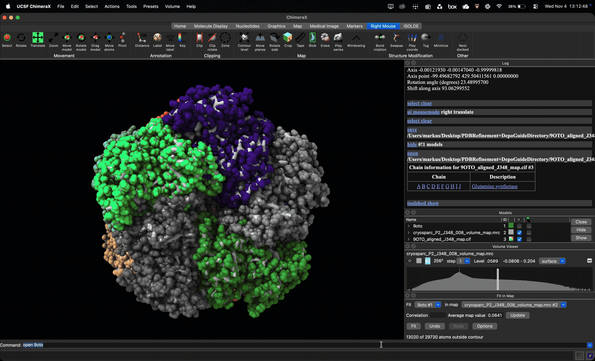
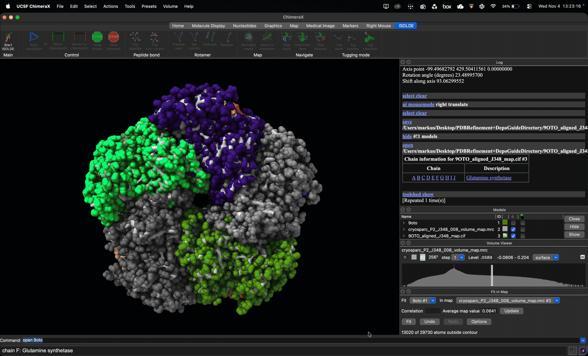
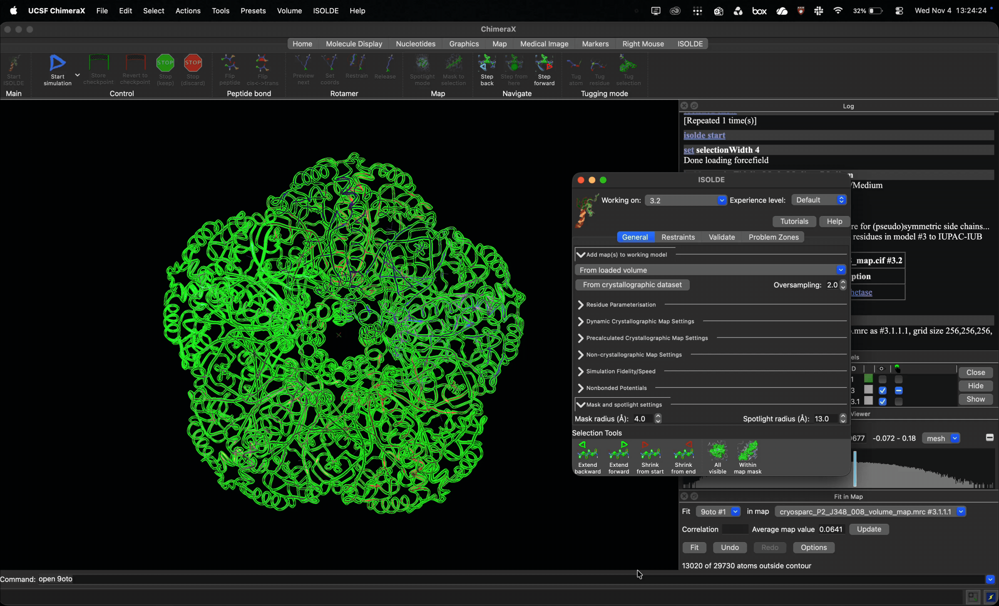
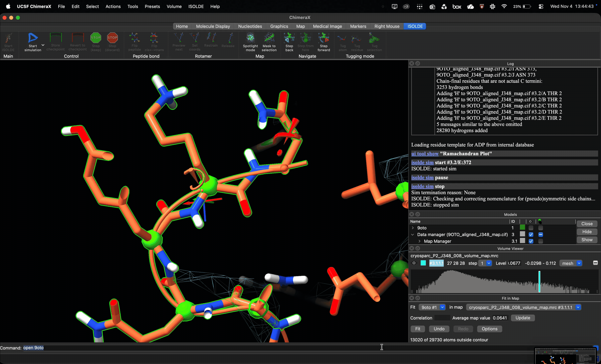

# Utilizing ISOLDE to reduce Ramachandran Outliers
As mentioned in the [background](Background.md), ISOLDE is available on both SBGrid and the Toolshed for ChimeraX. It is recommended to go through the Toolshed to ensure that ISOLDE is installed in the proper place and path.

To install ISOLDE, navigate to tools -> more tools. This will open the Toolshed tab, you can search for ISOLDE or select EM on the side panel where you can find ISOLDE listed there. ISOLDE is also available on the home page as a 'Top Downloaded Bundle'

Restart ChimeraX and following prompts accordingly.

Open your map and aligned structure, select these in ISOLDE as prompted:

Next, go to the Validate tab and check for any unparameterized residues before proceeding. It will prompt you to add hydrogens, feel free to select OK and proceed. After, double check to ensure all residues are parameterized before continuing. Next, open the Ramachandran plot. Select residues that are recognized as outliers then press **Start Simulation**. Run the simulation for several seconds (10-15s), you can pause the simulation, select Stop and Keep, or Stop and Discard if you are unhappy with initial refinement.

You may also tug on atoms and residues to fix rotamers or move the backbone into the density:

After you are happy with results from ISOLDE refinement, we can proceed to Phenix Real Space Refinement. Save your ISOLDE refined structure as `.cif`.
