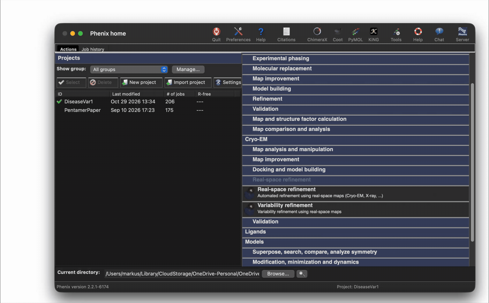
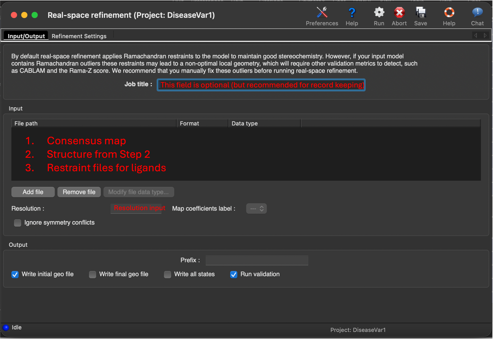
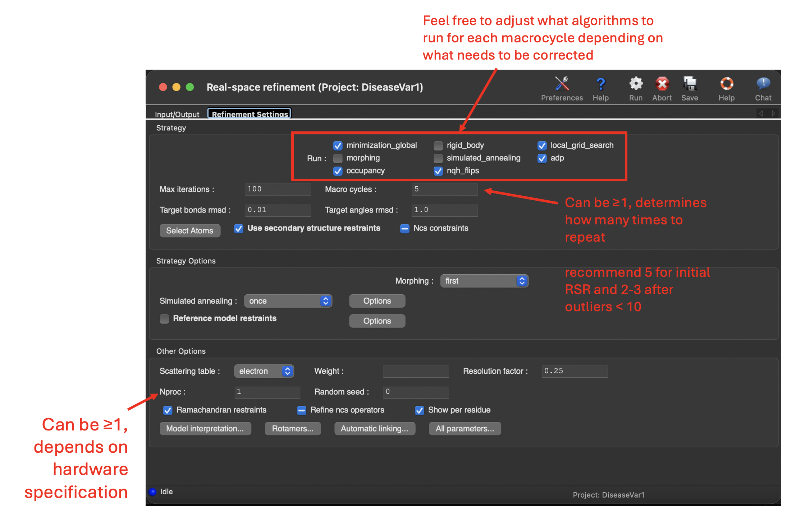
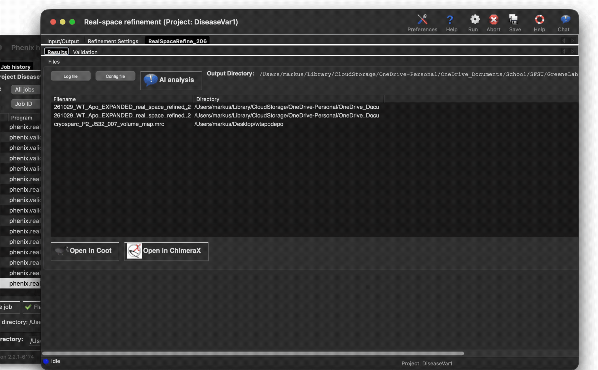

# Real Space Refinement with Phenix
The following files are required to run Real Space Refinement and Comprehensive Cryo-EM Validation on Phenix:
* Your consensus map
  * Note your resolution from CryoSPARC
* Your ISOLDE refined structure (`.cif`) from Step 2
* Restraint files for any ligands
  * Some restraint files are available on BOX

  If you do not have restraint files you can generate them through two means.
  1. Phenix eLBOW
  2. Grade2/Grade Web Server

  Phenix eLBOW utilizes AM1 QM to define ligand restraints which is sufficient for PDB deposition, however, it is not the same algorithm that RCSB/PDB uses. Grade2 utilizes a version of CSD Mogul which aligns with RCSB/PDB parameters and is the recommended version for Phenix RSR and Comprehensive EM Validation runs.

  Grade2 is free and is accessible through https://grade.globalphasing.org/cgi-bin/grade2_server.cgi
  
  Phenix eLBOW can also potentially utilize CSD Mogul, however CSD Mogul. requires a paid license to access. There are no free educational licenses available aside from accessing the Grade Web Server.

  A small selection of restraint files are available in BOX.

This guide utilized Phenix ver. 2.2.1-6174

  ## Set-up
  A fresh install of Phenix will prompt you to create your first project and define its directory. Typical structure will be for each paper/project (e.g. Disease Variant 1, Pentamer Paper, ecGS, ASS1). Jobs will allow you to define a title which is where it will be helpful to note the structure and mutant (e.g. Mutant MSO, Mutant turnover, WT apo, WT apo state 1, Decamer, Pentamer).

  ## Real Space Refinement (RSR)
  Navigate to Real Space Refinement under the Cryo-EM Header, click to expand, then click Real Space Refinement to open a window.

  

  This will open a Real Space Refinement window. The first tab (Input/Output) is where you may upload all necessary files:
  1. Your consensus map
  2. Your ISOLDE refined structure (`.cif`)
  3. Any applicable restraint files

  Title the job accordingly and input the cryo-EM map resolution.

  

  The next tab (Refinement Settings) has all the different operations used for RSR. For your initial run, I recommend keeping everything at default. There is an `nproc` field that you may define a value >1 which will tell the program to use the defined number of CPU cores for atomic displacement parameter (B-factor) refinement. You may also leave this field defaulted to 1.

  

## Reviewing Validation Report after RSR (or Comprehensive Cryo-EM Validation Report)
After your initial run, a validation report is completed and available for your review. To access this report, select the validation tab next to results.

The crucial fields to check and take note of will be Bond Angle and Length outliers and clashes. The summary page will list any fields that require your immediate attention in red while yellow are moderate outliers or issues. **PDB deposition can occur without a perfect validation report** What is crucial is to ensure that there are no Bond Angle or Length outliers as well as clashes.

As of 11/04/2026 on Phenix ver. 2.2.1-6174, the summary page does not accurately report Bond Angle or Length outliers >4σ. **Be sure to manually check the Molprobity report and the Geometry Restraints tab to ensure there are no outliers listed**

  ## Iterating through RSR
  If there are still a significant amount of outliers listed, you may run through RSR several times to correct those errors until you get a satisfactory Molprobity report. To repeat on your new structure, just replace your current model with the model output from the previous job.

  For example, if your initial run was on `9OTO_J348_aligned_ISOLDE.cif` it will yield the following output `9OTO_J348_aligned_ISOLDE_real_space_refined_001.cif`. This output can be used as the new input file for the next iteration. More generally, the `_real_space_refined_xxx.cif` file will be the input for the next run.

  If outliers are <10, it is recommended to proceed to step 4 to selectively refine those regions compared to iterating through RSR several more times.

Take note of the outliers or clashes reported or have Phenix open as you proceed to the next step. These values and data will be important for Coot and navigating to the outliers.