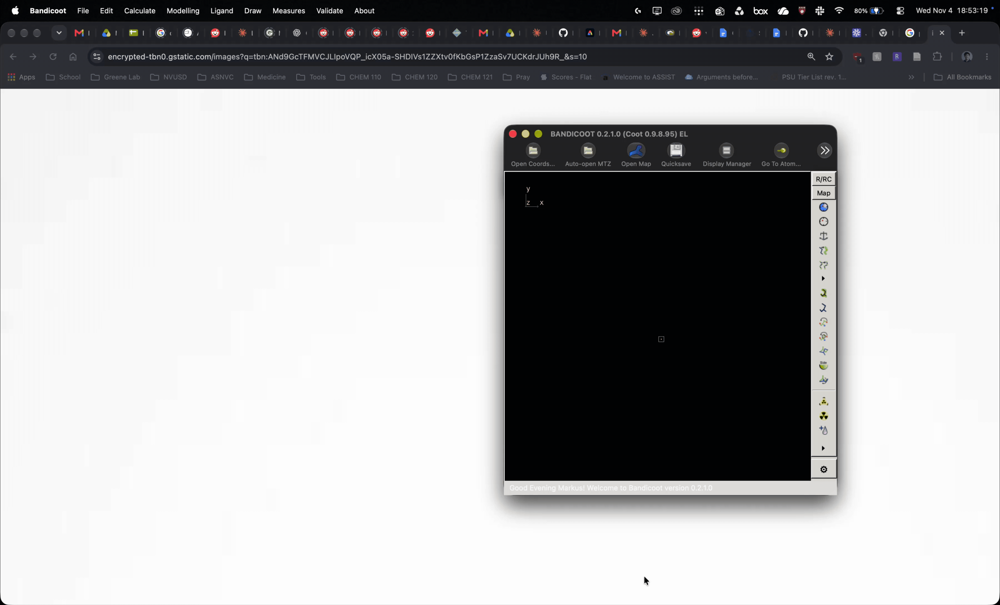
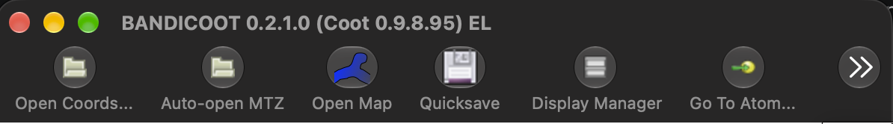
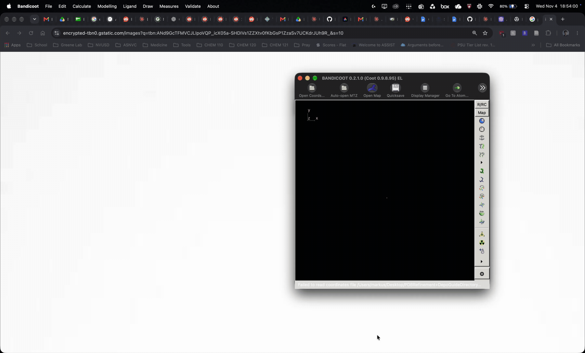
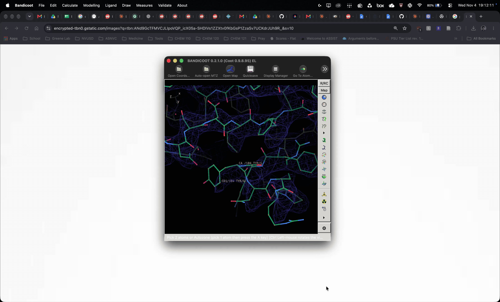
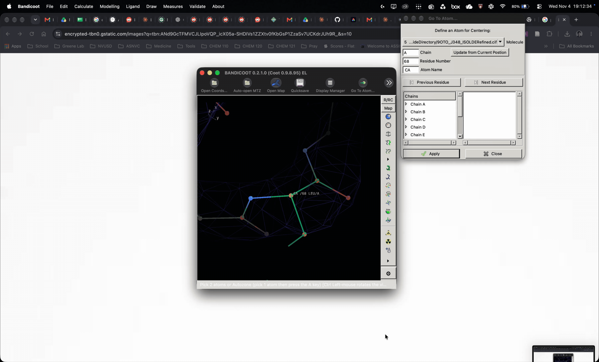
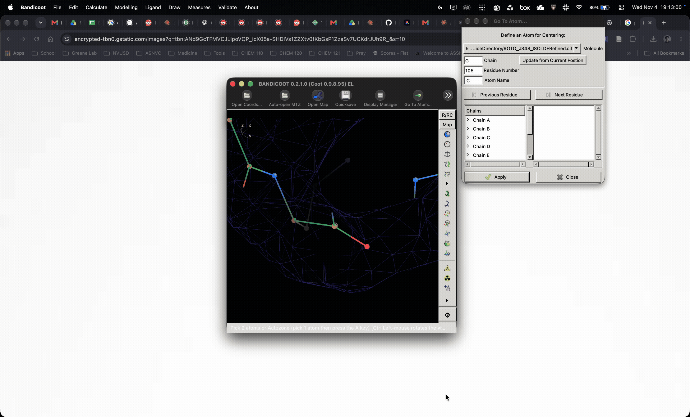

# Utilizing Coot for Selective Real Space and Regularization Refinement
This portion of the guide will be using Bandicoot ver. 0.2.1.0. The guide should be applicable to any future version of Bandicoot as well as Coot ver. 0.9.8.x as well as 0.9.8.x-ARM (for ARM processors, i.e. M-series Apple Processors or Qualcomm SnapDragon Processors)

Bandicoot will be referred to as "Coot" this guide.

Coot is particularly powerful as it allows us to selectively refine a series of residues or a single residue based on Cryo-EM map density (real-space refinement) or based on canonical amino acid restraints (regularization). Before continuing, it's important to differentiate between the two algorithms.

**Real-space refinement:** Uses a map-fit algorithm to align the selection to the density as well as enforcing amino acid geometry restraints (proper bond angles and lengths).\
**Regularization:** Does not use a map-fit algorithm and will only focus and prioritize enforcing amino acid geometry restraints.

Depending on the situation, you may use RSR or use regularization only.

## Importing your structure and map
I heavily recommend moving your Phenix refined structure and map to a folder on Desktop as it will be easier to locate these files. You can drag and drop your structure file into the session or go to file -> open coordinates and import it that way. Your map will need to be opened by going to file -> open map then select and import your map. The map will be in a 'mesh' style.

You may also open your coordinates and map using the toolbar options.

## Refining in Coot
It's recommended to have the Phenix or PDB validation report or notes of outliers in the background so you know which residues and atoms you need to navigate to. In this example we will need to correct the following outliers:\
* Bond Length: Chain A, Residue 68 Leu CA, CB, CG
* Bond Angle: Chain G, Residue 105 Asn C, N, Residue 104 Tyr N

**Fixing Bond Length of Side Chain**\
Recommended to use Real-space refinement to try and fit sidechain to density. A report window is opened, all categories should be green. If not, feel free to tug on the side chain or backrub the rotamer depending on the category requiring adjustment.

Selecting the tool, you will be required to make 2 selections. If you are refining only a specific residue and sidechain such as residue 68, you can double click on the CA as shown.

**Fixing Bond Angle of Backbone**\
Can use either Real-space refinement or regularization. A report window is opened, all categories should be green. If not, feel free to tug on the backbone or backrub the rotamer depending on the category requiring adjustment.

After selecting the tool, you will be required to make 2 selections. Since we want to correct bond angle outliers of the backbone, we will select the initial residue (Residue 104 N) then use the 'Go to' atom window to locate the following atom past the peptide bond (Residue 105 C).

## Validation
Save your coordinates then re-run validation in Phenix, revisit step 3 guide as necessary. If the validation report is satisfactory, proceed to Step 5 and 6. If not, feel free to run the structure through Phenix or attempt to fix outliers in Coot.

