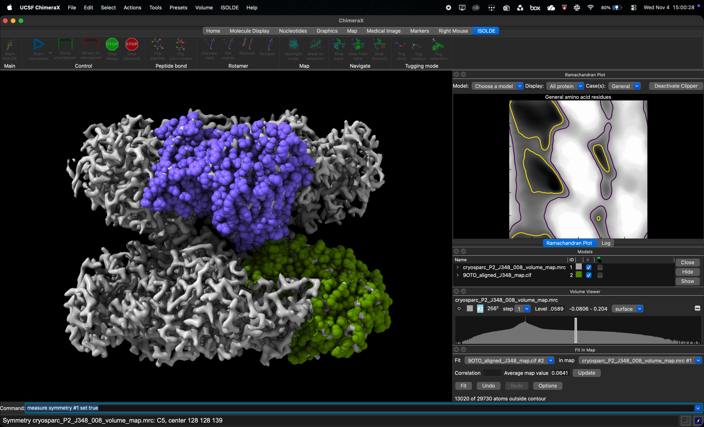

# Symmetry Expansion in ChimeraX
After completing the previous steps and the structure no longer has any major validation outliers, then we can proceed with symmetry expansion if you had deleted any subunits in Step 1. This will require 2 files:
1. Your refined asymmetric units
2. Your consensus map

The order of the model pane will be the following:
1. Map
2. Structure

First, symmetry of the map must be measured using: ```measure symmetry #1 set true```\
This will measure the map symmetry as well as the origin of model #1 which should be your map.

Next, we will expand our asymmetric units by using: ```sym #2 symmetry #1 copies true```\
This will make copies of your asymmetric unit (model #2) then make a new model (model #3) which will have all subunits as a subgroup. To fix this we just have to run ```combine #3``` which will make a new model named combination (model #4).

You can save model #4 as both as ```.pdb``` and ```.cif``` file. Before continuing, it is recommended to run the full structure through Phenix Comprehensive EM Validation or the wwPDB validation server before proceeding to step 6. After receiving a satisfactory report, you may continue with step 6, deposition. If not, revisit any outliers in Coot.

Click thumbnail to view video on symmetry expansion in ChimeraX.
[](../assets/Refinement+Dep/fullvideo/Step5_ChimeraXSymExpansion_2.mp4)

## Check before proceeding to Step 6
Before beginning a deposition session, be sure to check that secondary structures are properly modeled. If not, run `dssp #1` which will then properly model secondary structures. Save as both a `.cif` and `.pdb`.

Any time the model is ran through Phenix or Coot, be sure to check secondary structure modeling before proceeding (or returning) to the deposition session.
