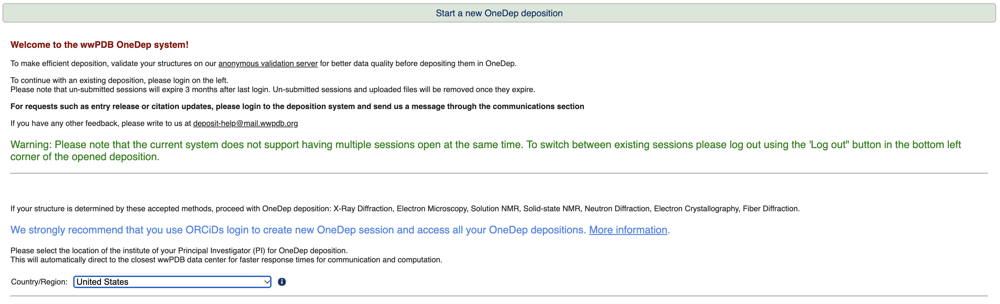
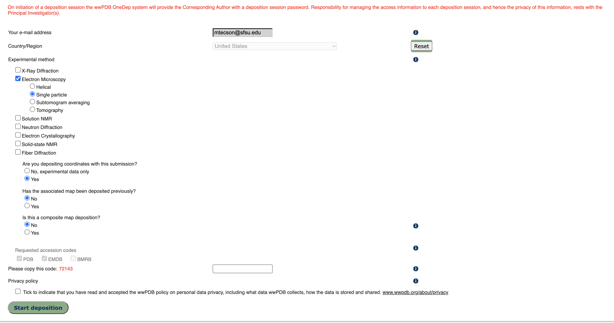
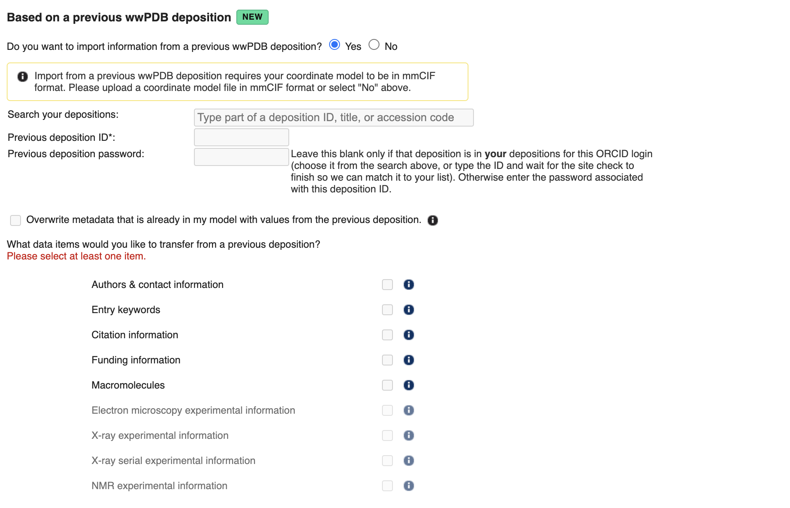

# PDB Depositions through OneDep
This step discusses the deposition process using OneDep and PDB Extract. Here are some files that are necessary for the deposition process:
1. Your consensus map
2. Your half maps (half map A and half map B) for GSFSC calculations
3. The FSC mask calculated by CryoSPARC for GSFSC calculations
4. The GSFSC curve as .xml from CryoSPARC
5. A picture of the map (this can be taken from ChimeraX)
6. Your solved structure

Total files: 7 (2 half maps)

For your maps and masks note the following:
* Pixel size (dependent on collection, available on CryoSPARC and in the ```.mrc``` header)
* Contour (available in ChimeraX)
  * Contour for FSC mask is always 1

In addition to those 7 files, it is recommended to also have an ORCID to easily access all depositions and share it with all other authors. To create an ORCID visit [orcid.org](https://orcid.org/)

After ensuring you have all files and your ORCID, discuss with Dr. Greene or your team the deposition strategy. Many cryo-EM data collections will have similar settings so you can import most fields from an initial or previous deposition session. Additionally, you may gather cryo-EM  collection metadata from an deposited ```.cif``` file using [PDB extract](https://pdb-extract.wwpdb.org/) Option A.

If you have a master metadata file, it is recommended to combine your final structure from the previous step using [PDB extract](https://pdb-extract.wwpdb.org/) Option B. Additionally, Option B is particularly useful for repairing and converting broken ```.pdb``` files to the ```.cif``` format for deposition.

## Starting a Deposition Session
After setting up your ORCID and any other preprocessing steps using PDB Extract it's time to start a deposition session. Depositions may also be initiated through Phenix provided you input an up-to-date API key.

This introduction comes straight from the PDB Deposition Server:\
"Welcome to the wwPDB OneDep system!
To make efficient deposition, validate your structures on our [anonymous validation server](https://validate.wwpdb.org/) for better data quality before depositing them in OneDep.

To continue with an existing deposition, please login on the left.
Please note that un-submitted sessions will **expire 3 months** after last login. Un-submitted sessions and uploaded files will be removed once they expire.

**Warning: Please note that the current system does not support having multiple sessions open at the same time. To switch between existing sessions please log out using the 'Log out" button in the bottom left corner of the opened deposition.**"

First select your region then enter appropriate information. The code provided will differ from each deposition session, this is also **NOT** the password to access the deposition. This information will be emailed to you after starting.




## Completing the deposition process
After initiating a deposition session, you must upload the 7 files listed previously. The GSFSC `.xml` file is **OPTIONAL** but we will make every attempt to provide GSFSC data. After you upload and begin processing the data, an upload summary will be provided.

On the upload page, you may also import deposition metadata from another session if provided the necessary information (Your list of Depositions that you have worked on **OR** Deposition ID and password)



If you completed preprocessing (Option A **AND** B) through PDB Extract, this step is not necessary.

The upload summary will list any cis-prolines in the structure, ensure that the number is as expected and aligns with the cryo-EM density. Additionally, any major geometry outliers not detected in previous Phenix validations will be listed here. If there are any outliers listed, return to Coot or Phenix to correct the outliers.

If there are no outliers, proceed to the admin folder and information. Fill out to the best of your ability, contact co-authors as necessary to gather their ORCID. By inputting their ORCID they will also have access to the deposition session will be able to help you as needed. **NOTE:** The author list does not have to be the same as the paper, if you are not the first author be sure to list the first author(s) at the minimum.

Consult with Dr. Greene regarding grant information and release status.

Feel free to use `PDB: 9OTO` as a guide on for naming the Entry title & authors page.

## Notes
It may take 30-40 minutes for a preliminary validation report to be provided to you. Any major geometry outlier will be flagged in this tab as well as in the `.pdf` report provided to you (accessible by download in the same tab). Fix in Coot or Phenix as necessary.

Additionally, the preliminary validation report will compare your structure quality to the entire PDB as well as all structures solved using EM.

If the validation report states that "Molprobity failed to run properly." This may be an issue with your coordinate file. PDB Extract may repair these files, additionally, `.pdb` conversion to `.cif` may also solve any issues.